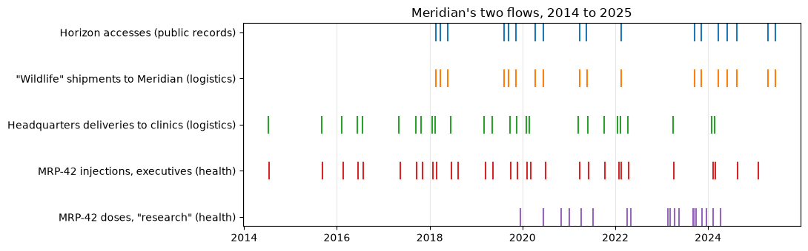

# Multi-source data mining: finding a hidden story across four datasets

A group data-mining project (Master 2 AI / Data Science). Four synthetic datasets from unrelated domains (public records, health, ecology, logistics) hide one coherent story. Each dataset is cleaned and analysed on its own, then a synthesis notebook cross-links the results and checks the links directly in the data.

> The data and the story are fictional. The notebooks are written in English.

## What the analysis finds

| Finding | Datasets | Evidence |
|---|---|---|
| After **each** of 14 observable night-time accesses by one organisation to natural sites, bat counts drop by about **59%** | public records + ecology | comparison with the seasonal norm, placebo test (p ≈ 0.0005) |
| **18 out of 18** refrigerated shipments leave exactly 6 h after the end of one of these accesses | public records + logistics | cross-referencing dates and sites |
| Biological lots **disappear from the stocks** of the warehouses receiving these parcels | logistics | inventory gaps, stock adjustments |
| **10 patients** show physiological signals incompatible with a human norm (two independent cardiac rhythms, atypical gait) | health | PCA, hierarchical clustering, DBSCAN, ECG signal analysis |
| **8 executives** have a biological age about 13 years below their actual age; **30 injections out of 30** match a stock withdrawal on the same day | health + logistics | permutation test, cross-referencing the tables |



*Figure from the synthesis notebook: each row is a type of event. The accesses and the "wildlife" shipments overlap exactly, while the clinic deliveries and the injections start four years earlier: two distinct flows.*

The full investigation, step by step, is in [`notebooks/00_synthesis.ipynb`](notebooks/00_synthesis.ipynb).

## Methods used

- **Data cleaning and quality**: duplicate detection, outliers flagged rather than deleted, cleaning log
- **Descriptive statistics**: distributions, Pearson and Spearman correlations
- **Dimensionality reduction and clustering**: PCA, t-SNE, hierarchical clustering, k-means, DBSCAN
- **Anomaly detection**: IQR, z-score, modified z-score, Isolation Forest, LOF, ABOD
- **Pattern mining**: frequent itemsets and association rules (Apriori)
- **Graphs and processes**: centralities, Louvain communities, process mining (directly-follows graph, Heuristic Miner)
- **Time series and spatial analysis**: STL decomposition, autocorrelation, Moran's I, LISA
- **Text mining**: TF-IDF, LSA, LDA, n-grams
- **Careful causal reasoning**: placebo and permutation tests, checks on confounders (weather, devices, other species)

## Repository layout

```
├── data/                    Provided raw data, and cleaned data written by the notebooks
│   ├── public_records/
│   ├── ecology/
│   ├── logistics/           (+ clean/ written by the logistics cleaning notebook)
│   ├── health/
│   ├── health_clean/        written by the health cleaning notebook
│   └── data_dictionary.csv
├── notebooks/
│   ├── 00_synthesis.ipynb               Synthesis: links the four datasets
│   ├── public_records/public_records.ipynb
│   ├── ecology/ecology.ipynb
│   ├── logistics/                       01_cleaning, 02_analysis
│   └── health/                          01_cleaning, 02_full_analysis_appendix, 03_report, health_utils.py
└── requirements.txt
```

**Where to start?** With `00_synthesis.ipynb` for the overall result, then `health/03_report.ipynb`, the best example of a complete report on one dataset. `health/02_full_analysis_appendix.ipynb` is an optional appendix with every method tried, course by course. The notebooks keep their outputs, so there is no need to rerun everything to read them.

## Running the notebooks

```bash
python -m venv .venv
source .venv/bin/activate        # Windows: .venv\Scripts\activate
pip install -r requirements.txt
cd notebooks
jupyter notebook
```

Each notebook must be run from its own folder (it reads `../data/` or `../../data/`); Jupyter does this by default. Run the `01_cleaning` notebooks before the corresponding analyses: they create `data/logistics/clean/` and `data/health_clean/`.

## Use of generative AI

Each notebook states how generative AI was used for its part.

## Credits and license

Topic and datasets provided for the Data Mining course (Master 2, 2026-2027) by Antoine T. Richard. Beer-Ware license, see [`LICENSE`](LICENSE).
